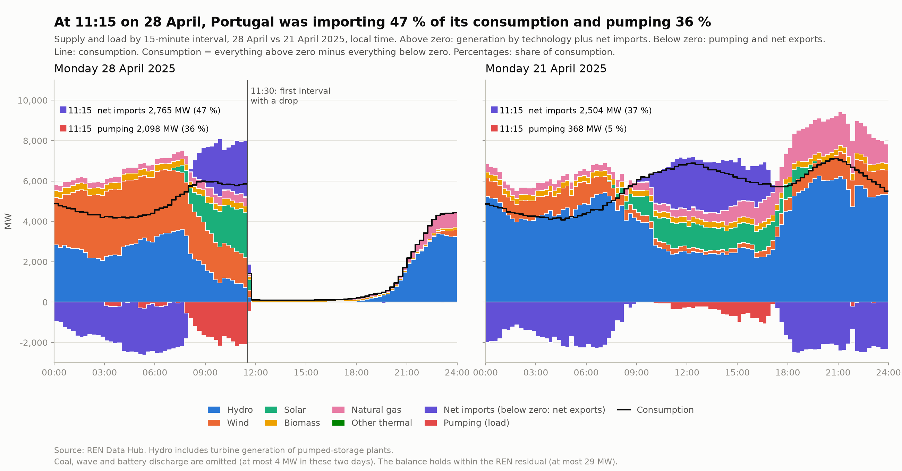
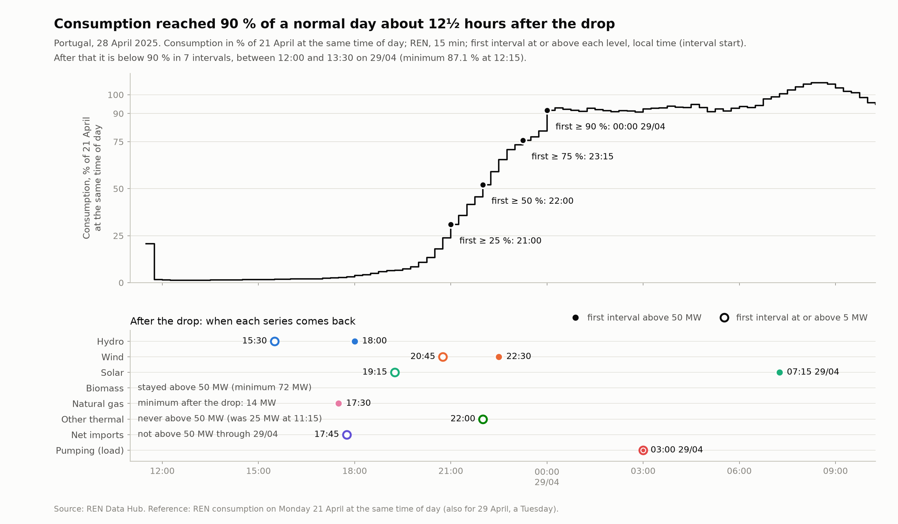

# sen-observatory

Personal project. Uses only publicly available data. Views and interpretations are my own and are not endorsed by, or affiliated with, any company.

A personal observatory of public data on the Portuguese electricity system (SEN, *Sistema Elétrico Nacional*): REN and ENTSO-E data loaded into DuckDB, compared and analysed in Python.

## Key findings

First factual look at the 28 April 2025 blackout, from REN 15-minute data. Times are Portuguese local time. This is a description of what the data show, not of causes. Full note: [docs/blackout_2025-04-28.md](docs/blackout_2025-04-28.md).

- At 11:15, the last complete interval before the drop, consumption was 5,861 MW. Net imports were 2,765 MW (47 % of consumption) and pumping was 2,098 MW (36 %).
- Synchronous generation (hydro, gas, biomass, other thermal) was 1,481 MW, below the lowest value for that hour on the 18 April weekdays used as reference (1,990 MW; average 2,678 MW). Inverter-based generation (wind and solar) was 3,735 MW, inside the April range.
- Consumption fell to 1,414 MW in the 11:30 interval and to 107 MW in the next. The minimum was 88 MW (1.3 % of the same time of day on 21 April) at 12:30.
- Measured against 21 April, consumption first reached 25 % at 21:00, 50 % at 22:00, 75 % at 23:15 and 90 % at 00:00 on 29 April, about 12½ hours after the drop. It was below 90 % again from 12:00 to 13:30 on 29 April.
- Hydro was at 0.7 MW or less until 15:30 (6.4 MW), then above 50 MW at 18:00. Gas never fell below 14 MW and was above 50 MW at 17:30. Solar reached 5 MW at 19:15 and wind at 20:45.





The data behind each figure are in [`figures/`](figures/) as CSV files.

## Data

- **[REN Data Hub](https://datahub.ren.pt):** 15-minute generation, imports, exports, pumping and consumption for Portugal, downloaded as CSV.
- **[ENTSO-E Transparency Platform](https://transparency.entsoe.eu):** generation, load, prices and PT↔ES flows for Portugal and Spain (April 2025), downloaded through the REST API.

[SOURCES.md](SOURCES.md) lists the series, the conventions (all timestamps in UTC) and the known issues. The main ones: the REN cogeneration column duplicates the CCGT gas column; ENTSO-E PT↔ES flows are offset by 15 minutes against REN; and the ENTSO-E Spanish series have a gap from 2025-04-28 10:30 UTC to 2025-04-29 22:00 UTC.

## How to reproduce

Requires Python 3.13 and [uv](https://docs.astral.sh/uv/).

```bash
git clone https://github.com/t-1998/sen-observatory.git
cd sen-observatory
uv sync
```

**Token.** Request an ENTSO-E API token and put it in a `.env` file in the project root (the file is git-ignored; the code never prints the token):

```
ENTSOE_API_TOKEN=your-token-here
```

**REN data.** The Data Hub has no API used here: download the CSV for each day from the site and put the files in `data/raw/ren/`. The blackout analysis needs 21, 28 and 29 April 2025.

**Load the data** into `data/sen.duckdb`:

```bash
uv run python -m sen_observatory.ren_loader data/raw/ren/*.csv
uv run python -m sen_observatory.entsoe_loader        # April 2025 by default; see --help
uv run python -m sen_observatory.comparison           # REN vs ENTSO-E for Portugal
```

**Run the blackout analysis.** It writes the figures and CSV files to `figures/` and prints the tables:

```bash
uv run python -m sen_observatory.analysis.blackout
```

**Run the tests.** They use synthetic data; the tests that need the real database are skipped if it is missing.

```bash
uv run pytest
```

## Project structure

```
src/sen_observatory/   Python package: loaders (ren_loader, entsoe_loader), comparison
  analysis/            blackout analysis and figures
  sql/                 SQL used by the comparison and the analysis
tests/                 pytest suite
docs/                  written analysis (draft of the 28 April 2025 note)
figures/               PNG figures and the CSV data behind them
data/                  raw files and DuckDB database (git-ignored)
```

## Limitations

REN and ENTSO-E values are 15-minute (REN) or hourly (ENTSO-E) averages. They show the system before the blackout and during the restoration, but not the collapse itself, which took place within seconds. For those dynamics, see the [ENTSO-E Expert Panel material on the 28 April 2025 blackout](https://www.entsoe.eu/publications/blackout/28-april-2025-iberian-blackout/).

## How this was built

This analysis was developed together with Claude (Anthropic), using Claude Code for the code. I defined the questions, made the methodological choices and reviewed the results.

## License and author

[MIT](LICENSE). Author: Tiago Felizardo ([t-1998](https://github.com/t-1998)).
