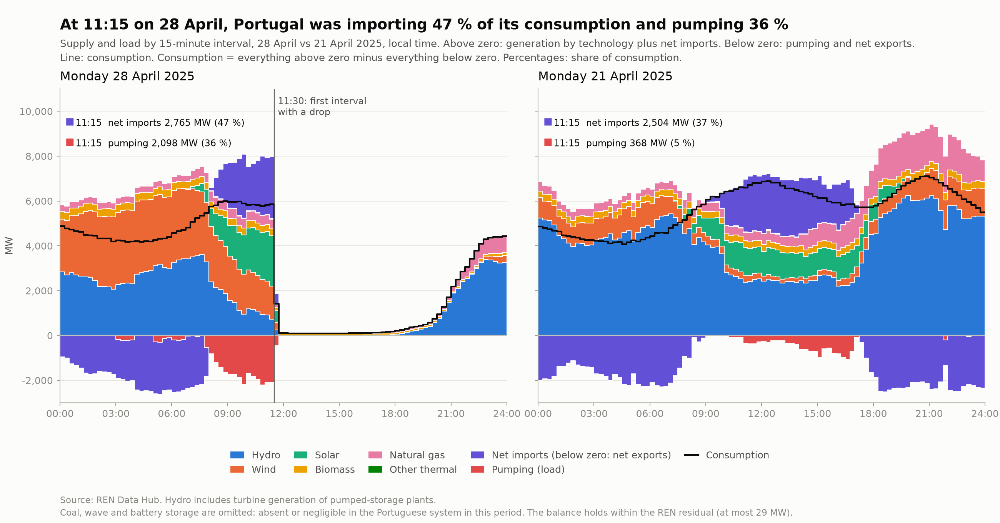
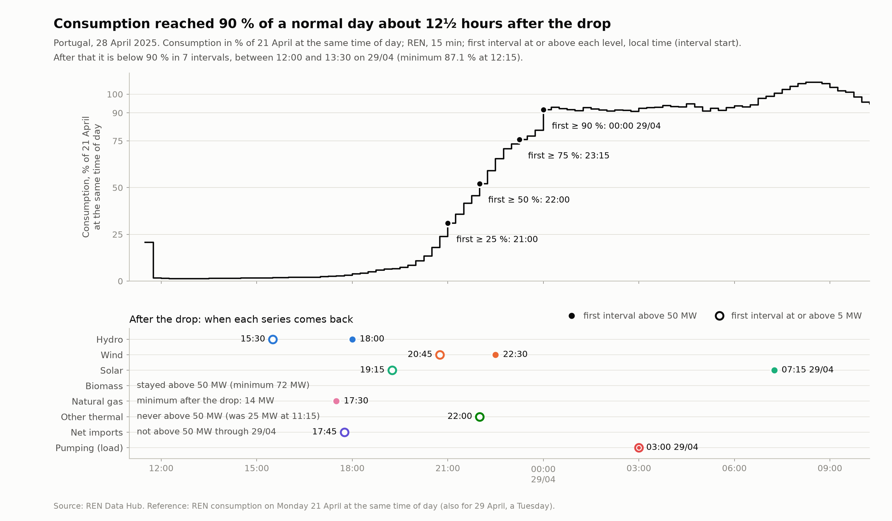

# Portugal on 28 April 2025: operating point and recovery (draft)

Draft findings from the REN Data Hub (15-minute data, main source, covering 28 and 29 April) and ENTSO-E (hourly data, used only for the April weekday average). Times are Portuguese local time and mark the **start** of each interval. This note describes what the data show; it does not discuss causes.

Code: `src/sen_observatory/analysis/blackout.py`. Data behind the figures: `figures/fig1_operation_data.csv`, `figures/fig2_restoration_data.csv`.

## 1. Operating point at 11:15

11:15 is the last complete interval before the first interval with a drop (11:30).

| Component | 28/04 11:15 | 21/04 11:15 | April weekdays, 11:00–12:00 mean (n=18) |
|---|---:|---:|---:|
| Hydro | 718 MW (12.3 %) | 2,413 MW (35.9 %) | 1,905 MW (28.8 %) |
| Wind | 1,485 MW (25.3 %) | 259 MW (3.8 %) | 1,591 MW (24.0 %) |
| Solar | 2,250 MW (38.4 %) | 1,208 MW (18.0 %) | 1,584 MW (23.9 %) |
| Biomass | 313 MW (5.3 %) | 298 MW (4.4 %) | 316 MW (4.8 %) |
| Natural gas | 424 MW (7.2 %) | 402 MW (6.0 %) | 439 MW (6.6 %) |
| Other thermal | 25 MW (0.4 %) | 23 MW (0.3 %) | 18 MW (0.3 %) |
| Net imports | 2,765 MW (47.2 %) | 2,504 MW (37.3 %) | 2,177 MW (32.9 %) |
| Pumping (load) | 2,098 MW (35.8 %) | 368 MW (5.5 %) | 1,433 MW (21.6 %) |
| **Consumption** | **5,861 MW (100 %)** | **6,723 MW (100 %)** | **6,618 MW (100 %)** |
| *Synchronous generation* (hydro + gas + biomass + other thermal) | 1,481 MW (25.3 %) | 3,136 MW (46.6 %) | 2,678 MW (40.5 %) |
| *Inverter-based generation* (wind + solar) | 3,735 MW (63.7 %) | 1,467 MW (21.8 %) | 3,175 MW (48.0 %) |

Percentages are shares of consumption. They do not add up to 100 %: pumping is a load, and the REN balance residual was 22 MW (28/04) and 12 MW (21/04).

Coal, wave and battery storage are omitted: they are absent or negligible in the Portuguese system in this period.

**April weekdays used (n=18):** 1, 2, 3, 4, 7, 8, 9, 10, 11, 14, 15, 16, 17, 21, 22, 23, 24 and 30 April. Left out: 18/04 (Good Friday) and 25/04 (public holidays), 28/04 (the event) and 29/04 (the day after).

**Groups.** The two last rows are descriptive groupings by technology. The pumping groups are also synchronous machines, but they run as motors: they are a load and are not part of synchronous generation. REN hydro includes the turbine generation of pumped-storage plants, so it is part of the synchronous group.

- **Net imports** were 2,765 MW, 47 % of consumption. They became positive (above 50 MW) at 08:00 and peaked at 2,837 MW at 09:45. On 21/04 they became positive at 09:00. The April weekday average at this hour is 2,177 MW, with values from 6 to 4,128 MW across the 18 days.
- **Pumping** was above 500 MW in every interval from 07:45 to 11:15 and reached 2,212 MW at 10:45, against a maximum of 1,066 MW on 21/04 (at 16:30). The April weekday average at this hour is 1,433 MW (range 33 to 2,229 MW).
- **Synchronous and inverter-based generation:** synchronous generation was 1,481 MW, below the lowest April weekday value for the hour (1,990 MW; average 2,678 MW). Inverter-based generation was 3,735 MW, inside the April range (1,471 to 5,388 MW; average 3,175 MW).
- **Single technologies:** wind, solar, biomass and gas were within the range seen on April weekdays at this hour. Hydro (718 MW) and consumption (5,861 MW) were below the lowest April weekday value for the hour (1,191 MW and 6,048 MW).

Caveat for the last column: ENTSO-E is hourly, so it is an hourly mean (11:00–12:00), not an 11:15 value. On 21/04 the hourly mean and the 11:15 value differ by at most 51 MW per component. The net imports of this column come from ENTSO-E flows, which are offset by 15 min against REN (see `SOURCES.md`).

## 2. Figure 1: both days, 00:00–24:00

- Before 11:30, mean hydro (00:00–11:15) is 2,387 MW on 28/04 against 4,278 MW on 21/04, and mean wind is 2,670 MW against 755 MW.
- From 07:45 to 11:15 on 28/04, pumping (above 500 MW) and net imports (above 50 MW from 08:00) are both high. Pumping energy was 6,956 MWh over the day: 6,842 MWh until 11:15, 114 MWh in the 11:30 interval and 0.5 MWh after it. On 21/04 it was 3,417 MWh.
- From 11:45 to 17:00 on 28/04, consumption stays at or below 131 MW and total generation at or below 135 MW. Net imports do not exceed 50 MW in any later interval through 29/04.

## 3. Recovery

Consumption on 28/04 after the drop, in % of the consumption on 21/04 at the same time of day (REN, 15 min, through 29/04).

| Step | Value |
|---|---|
| 11:30 interval | 1,414 MW (20.8 %) |
| 11:45 interval | 107 MW (1.6 %) |
| Minimum | 88 MW (1.3 %) at 12:30 |

First interval at or above each level, after the minimum:

| Consumption, % of 21/04 | First interval | Value |
|---|---|---:|
| 25 % | 21:00 | 31.0 % |
| 50 % | 22:00 | 52.1 % |
| 75 % | 23:15 | 75.7 % |
| 90 % | 29/04 00:00 | 91.6 % |

- At 23:45 on 28/04 the ratio is 80.7 % and at 00:00 on 29/04 it is 91.6 %. Over that step, 28/04 consumption goes from 4,433 to 4,448 MW, while the 21/04 reference falls from 5,493 to 4,854 MW.
- On 29/04 the ratio does not stay above 90 %. From 00:00 to 11:45 it is between 90.6 % and 106.4 %. From 12:00 to 13:30 it is below 90 % (seven intervals, minimum 87.1 % at 12:15). From 13:45 it is between 92.0 % and 105.7 %.
- The reference is a Monday (21/04) and 29/04 is a Tuesday. For comparison, the 18 April weekdays at 11:00–12:00 (ENTSO-E hourly mean) range from 90 % to 107 % of the 21/04 value. The 90 % level therefore sits inside the usual day-to-day variation relative to this reference day.

When each series comes back after the drop (REN, 15 min). The lower threshold, 5 MW, shows the first production after the drop; 50 MW shows a substantial return.

| Series | First interval at or above 5 MW | First interval above 50 MW |
|---|---|---|
| Hydro | 15:30 (6.4 MW) | 18:00 (61.7 MW) |
| Natural gas | never below 5 MW (minimum after the drop: 14 MW) | 17:30 (55.8 MW) |
| Wind | 20:45 (8.4 MW) | 22:30 (73.2 MW) |
| Solar | 19:15 (10.2 MW) | 29/04 07:15 (50.6 MW) |
| Biomass | never below 5 MW (minimum 72 MW) | stayed above 50 MW |
| Other thermal | 22:00 (5.4 MW) | never above 50 MW (25 MW at 11:15) |
| *Net imports* | 17:45 (5.2 MW) | not above 50 MW through 29/04 |
| *Pumping (load)* | 29/04 03:00 (155.8 MW) | 29/04 03:00 (155.8 MW) |

The rule: the first interval at or above 5 MW (above 50 MW) after the first interval below 5 MW (at or below 50 MW) from 11:30 on. Hydro stays at 0.7 MW or less in every interval before 15:30. Net imports and pumping are an exchange and a load, not technologies; they are listed for completeness.

## 4. Figure 2: recovery curve

The title counts from the 11:30 interval (the first with a drop) to the 00:00 interval of 29/04 (the first at or above 90 %): 12 h 30 min. The 90 % level is not held afterwards (see section 3).

## 5. Restoration context

Public statements, with their sources. They are not derived from the REN or ENTSO-E data.

- **Black start.** In Portugal, the plants with black-start contracts (autonomous start-up capability), Castelo de Bode (hydroelectric) and Tapada do Outeiro, were activated. Electrical islands were created around them and small loads were reconnected in small steps, about 5 MW at first and then 10 MW and 30 MW (INESC TEC). REN's update of 28 April reports that production was restored at the Castelo de Bode hydroelectric station and the Tapada do Outeiro thermoelectric station, with consumption resuming "first in the region of these power stations and then progressively in adjacent areas". REN and INESC TEC call Tapada do Outeiro a thermoelectric station; ERSE describes it as a gas combined-cycle plant. REN dates the power cut at 11:33.
  Sources: [REN, "Power outage across the Iberian Peninsula affects Portugal – Update 3", 28 April 2025](https://www.ren.pt/en-gb/media/news/power-outage-across-the-iberian-peninsula-affects-portugal-upadate-3); [INESC TEC, position paper on the blackout in Portugal](https://www.inesctec.pt/documents/PositionPaper_blackoutPT.pdf); [ERSE, "Investigação ao apagão ibérico de 28 de abril de 2025"](https://www.erse.pt/comunicacao/comunicados/ersexplica-investigacao-ao-apagao-iberico-de-28-de-abril-de-2025/).
- **Load restoration timeline (E-Redes).** According to the timeline presented by the president of E-Redes at a parliamentary hearing, the first attempt at load restoration was at 14:45, through Castelo de Bode, followed at 15:31 by restoration from the Zêzere injection point. The same report says generalised resumption was only achieved from 21:00, when the system could accept more load.
  Source: [RTP, "Apagão. E-Redes afasta responsabilidades na distribuição de energia e aponta dependência da REN"](https://www.rtp.pt/noticias/economia/apagao-e-redes-afasta-responsabilidades-na-distribuicao-de-energia-e-aponta-dependencia-da-ren_n1708529).

What the REN data show around these times (national totals, 15-minute averages, MW):

| Interval | Consumption | Hydro | Natural gas |
|---|---:|---:|---:|
| 14:30 | 98.3 | 0.0 | 16.5 |
| 14:45 | 99.2 | 0.7 | 16.1 |
| 15:00 | 97.2 | 0.0 | 14.2 |
| 15:15 | 97.7 | 0.4 | 14.3 |
| 15:30 | 105.0 | 6.4 | 15.0 |
| 15:45 | 109.3 | 9.2 | 16.2 |
| 16:00 | 114.6 | 10.7 | 19.2 |

- **Hydro** is 0.0 MW in every interval from 12:00 to 14:30. It is 0.7 MW in the 14:45 interval, back to 0.0 MW at 15:00 and 0.4 MW at 15:15. In the 15:30 interval, which contains 15:31, hydro is 6.4 MW, its first interval at or above 5 MW, and consumption rises by 7.3 MW. Hydro is above 20 MW at 17:00, above 50 MW at 18:00 and above 100 MW at 18:30.
- **Natural gas** never falls below 5 MW after the drop (minimum 14 MW). It stays between 14 and 17 MW from 12:00 to 15:45, with no visible change at 14:45 or at 15:30. It is above 20 MW at 16:45, above 50 MW at 17:30 and above 100 MW at 20:30.
- **Consumption** changes by between −3 and +10 MW per interval from 15:30 to 17:15, by +17 and +19 MW at 17:30 and 17:45, by +42 MW at 18:00 and by +28 to +62 MW per interval from 18:15 to 19:00. It is 401 MW at 19:00 (6.3 % of the 21/04 value) and 2,177 MW at 21:00 (31.0 %).
- **Limits of the comparison.** The values at 14:45 and 15:30 are small (consumption is about 100 MW) and the data are national 15-minute totals. They do not say which plant or injection point a value belongs to, and the individual load steps described by INESC TEC cannot be identified in them. The timing of these small changes is noted, not matched to the statements.

## Limits

- REN intervals are 15-minute averages. The 11:30 value (1,414 MW of consumption) lies between the 11:15 and 11:45 values, so it cannot be read as a steady state, and nothing shorter than 15 minutes can be read from these data.
- The April weekday average (section 1) is ENTSO-E hourly: an hourly mean, not an 11:15 value.
- The reference is one day (21/04, a Monday), also used for 29/04 (a Tuesday). Day-to-day variation of April weekdays is of the same order as the 90 % level (see above).
- REN hydro includes the turbine generation of pumped-storage plants.
- Spain is not covered here: the ENTSO-E Spanish series have a gap from 2025-04-28 10:30 UTC to 2025-04-29 22:00 UTC (see `SOURCES.md`).
